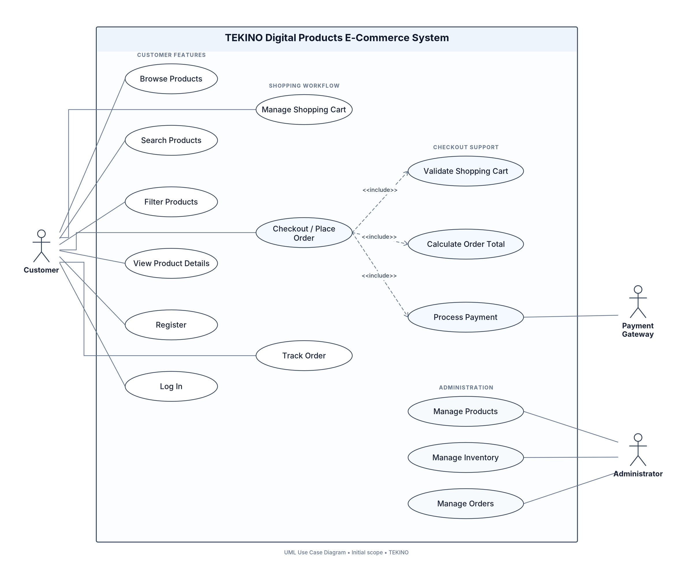
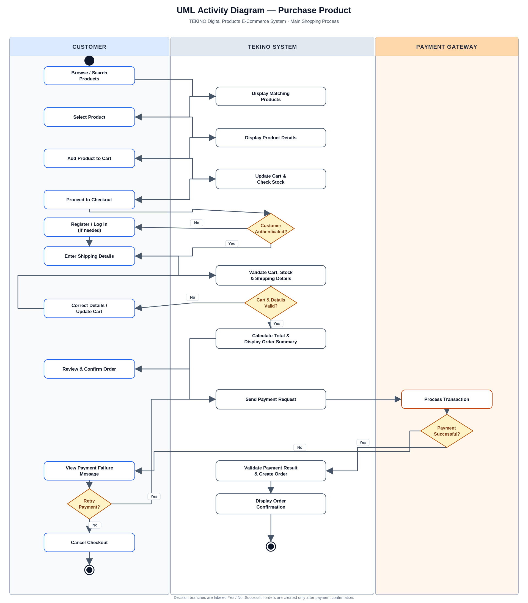

# TEKINO — Digital Products E-Commerce System

## 1. Project Overview

TEKINO is an academic software engineering project focused on an e-commerce system for digital products, including smartphones, laptops, tablets, headphones, smartwatches, and accessories.

The project documents the system's stakeholders, requirements, user stories, Product Backlog, Agile Sprint planning, and UML models.

**Project Type:** Academic Software Engineering Project  
**Development Approach:** Agile  
**Current Phase:** Requirements Analysis and UML Modeling

## 2. Product Vision

To provide customers with a simple, reliable, and user-friendly online platform for discovering and purchasing digital products.

## 3. Project Objectives

- Identify stakeholders and analyze their needs.
- Define functional and non-functional requirements.
- Create five user stories with acceptance criteria.
- Establish and prioritize a Product Backlog.
- Plan development work using an Agile Sprint.
- Model system behavior using UML Use Case and Activity Diagrams.
- Maintain project documentation and change history using GitHub.

## 4. Agile Development Approach

The project follows an iterative and incremental Agile approach.

The Product Backlog organizes and prioritizes planned product work. During Sprint Planning, selected backlog items are assigned to a Sprint Goal and broken down into tasks.

The initial Sprint 1 plan focuses on product discovery and viewing product details through the following user stories:

- US-01 — Browse and Search Products
- US-02 — View Product Details

The planned total is 8 Story Points. This is a planning estimate, not a record of completed implementation.

The team should review completed work, collect feedback, refine the Product Backlog, and use the results to inform subsequent Sprints.

## 5. Project Documentation

### Project Analysis

- [Stakeholder Identification](02-Stakeholders/stakeholders.md)
- [Functional Requirements](03-Requirements/functional-requirements.md)
- [Non-Functional Requirements](03-Requirements/non-functional-requirements.md)

### Agile Planning

- [User Stories and Acceptance Criteria](04-User-Stories/user-stories.md)
- [Product Backlog](05-Product-Backlog/product-backlog.md)
- [Sprint 1 Planning](06-Sprint-Planning/sprint-01.md)

### UML Models

- [Use Case Analysis](07-UML/use-case-analysis.md)
- [Use Case Diagram — PNG](07-UML/use-case-diagram.png)
- [Use Case Diagram — Editable draw.io File](07-UML/use-case-diagram.drawio)
- [Activity Diagram — PNG](07-UML/activity-diagram.png)
- [Activity Diagram — Editable draw.io File](07-UML/activity-diagram.drawio)
- [Activity Diagram — SVG](07-UML/activity-diagram.svg)
- [Activity Diagram Notes](07-UML/activity-diagram-notes.md)

### Requirements Traceability

- [Requirements Traceability Matrix](08-Documentation/requirements-traceability.md)

## 6. UML Diagrams

### Use Case Diagram

The Use Case Diagram identifies the main actors and their interactions with the TEKINO system.

[Open the editable Use Case Diagram](07-UML/use-case-diagram.drawio)

### Activity Diagram — Purchase Process

The Activity Diagram represents the main purchase workflow, including product selection, cart validation, checkout, payment processing, and the successful and unsuccessful payment paths.

[Open the editable Activity Diagram](07-UML/activity-diagram.drawio)

## 7. Quality Requirements

The initial non-functional requirements cover:

- Performance
- Security and access control
- Reliability and data integrity
- Usability and responsiveness
- Browser compatibility
- Maintainability
- Privacy
- Availability and recovery

These requirements are proposed targets and constraints. Their verification results must be recorded only after the relevant reviews or tests have been performed.

## 8. Project Scope

### In Scope

- Product browsing, search, and filtering
- Product details
- Customer registration and login
- Shopping cart management
- Checkout and online payment interaction
- Order tracking
- Administrative product, inventory, and order management

### Initially Out of Scope

- Native Android and iOS applications
- Internal management of delivery company operations
- A multi-vendor marketplace

## 9. Current Project Status

The repository currently contains the initial project overview, stakeholder analysis, requirements, five user stories, Product Backlog, Sprint 1 plan, UML diagrams, and requirements traceability documentation.

The project is currently focused on analysis, planning, and modeling. Software implementation and test execution are not claimed as completed.

## 10. Academic Reference

Pressman, Roger S., and Bruce R. Maxim. *Software Engineering: A Practitioner's Approach*, 8th and 9th editions.

This project applies relevant software engineering concepts to requirements analysis, Agile planning, and UML modeling.

---

**Project:** TEKINO — Digital Products E-Commerce System  
**Repository Purpose:** Academic documentation and modeling for a proposed e-commerce system.
